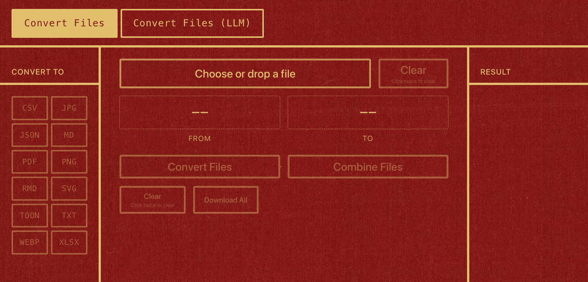
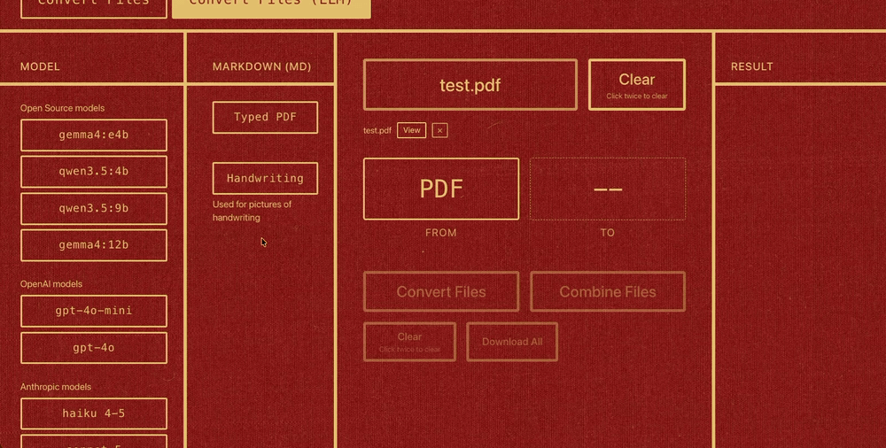

# File Converter





## Run it

Built and tested on macOS only. Several converters depend on macOS paths and tools (Chrome,
LibreOffice, the Menlo font, `brew` installs), so on Linux or Windows expect some of them to fail.

Install the [system tools](#system-tools) first. `uv sync` and `pnpm install` only cover the
Python and frontend packages, and the backend won't start without libmagic.

```bash
# Terminal 1: frontend
cd frontend && pnpm install && pnpm dev

# Terminal 2: backend (the flags are required)
uv sync
uv run uvicorn server:app --app-dir backend --reload --port 8019 --loop asyncio
```

Open the address Vite prints. Both have to be running.

Pick files, pick a target format, convert, download. **View** previews a file before or
after converting. The **Convert Files (LLM)** tab turns PDFs and handwriting photos into
Markdown with an LLM: local Ollama (free, pull the model first with `ollama pull <model>`),
OpenAI, or Anthropic (the last two cost money and need `OPENAI_API_KEY` or
`ANTHROPIC_API_KEY` in a `.env` file at the repo root, copy `.env.example` to start).

## What it converts

- **PDF** to Markdown (OCR or LLM), PNG
- **Word** to Markdown, PDF
- **PowerPoint** to PDF, Markdown
- **Markdown, HTML, TXT, SQL, Jupyter, R Markdown** to PDF
- **Excel, CSV** to each other, CSV to Markdown
- **JSON and TOON** to each other, TOON to Markdown or PDF, and the tables in Markdown or PDF to TOON
- **JPG, PNG, GIF, WebP, HEIC** to PDF, PNG, JPG, WebP, SVG, Markdown or text (which ones depends on the source)
- **SVG** to PDF, PNG
- **MP4** to Markdown: speech (Whisper, downloaded on first use) and on-screen text (OCR), under
  the Video option on the LLM tab
- Combine several files of one type into one

Every script is in `backend/<from>_<to>.py`. Each runs on its own: create `backend/input/` (it is
gitignored, so a fresh clone doesn't have it), drop files in, run the script, and find the results
in `backend/output/`.

## System tools

Only the conversion you use needs its tool:

```bash
brew install libmagic                   # web UI server, always needed
brew install tesseract                  # OCR
brew install pandoc                     # Word and Markdown conversions
brew install --cask mactex              # Markdown and Jupyter to PDF
brew install --cask libreoffice         # PowerPoint
brew install wkhtmltopdf                # HTML to PDF
brew install r                          # R Markdown, plus the rmarkdown R package
brew install ollama                     # local LLM
```

HTML to SVG and SVG to PDF or PNG need Google Chrome. Mermaid diagrams in Markdown to PDF need
`pnpm add -g mermaid-filter`.

## Good to know

- There is no login and the converters run on whatever you upload, so keep the backend on localhost
  (don't start it with `--host 0.0.0.0`) and don't convert files you don't trust.
- Converting a file again overwrites the old output, and the script prints a message when it does.
- Combine only works on files that share one extension, and keeps the order you added them.
- A file to convert is capped at 100 MB, and a video at 5 GB. Combine takes up to 500 MB across all its files.
- The web UI runs up to 4 conversions at once. A fifth (another tab, say) waits for a free
  slot, and the progress bar says "Waiting for another conversion...".
- Long PDFs on the LLM tab: the Claude path caps at about 100 pages (32 MB), and the
  OpenAI path can hit a rate limit and fail with no output. Use Claude for long ones.
- The LLM scripts convert every file in `backend/input/`, one at a time. If the files add up to
  more than 100 MB, they wait 30 seconds between files to go easy on memory.
- Markdown and PDF to TOON convert tables only, and a file with none fails. A PDF table needs ruling
  lines and two or more columns. TOON to PDF draws Latin text only, so Chinese or emoji fails instead
  of printing boxes.
- OCR is English-only on purpose. Other languages come back as garbled English, not an error.
- Handwriting reads better from a scan than from a phone photo.

Some chains give bad output, see [CONVERSIONS.md](CONVERSIONS.md).
